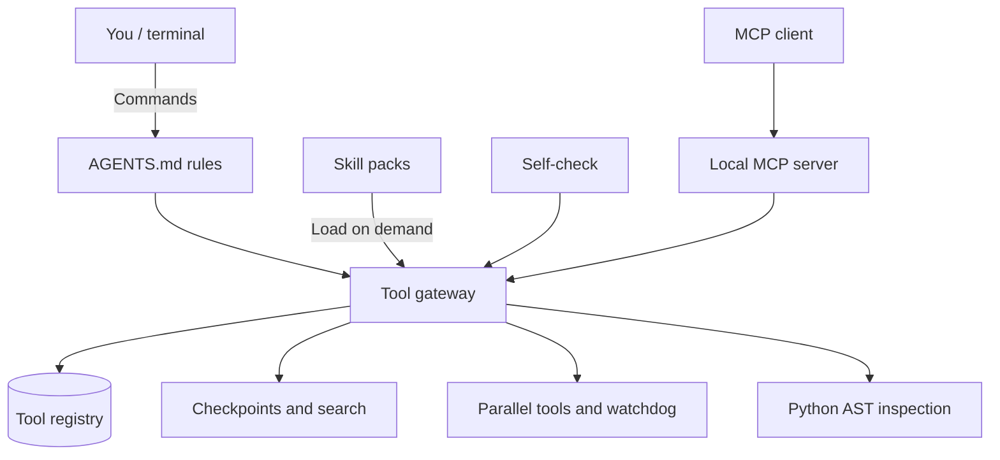

# cc-Harness

> **Give DeepSeek Harness a little Claude Code energy.**

[](https://github.com/kaihu8766-netizen/cc-Harness/actions/workflows/ci.yml)

A Claude Code-inspired toolkit for [DeepSeek Harness (DSH)](https://github.com/deepseek-ai/deepseek-harness), without a single line of model code. Bolt on **skill packs and a trigger index, a tool gateway, one-command checks, task checkpoints, a local MCP server, automatic retries, and a configurable personality**. Give your chat terminal the tools to get work done, show its receipts, and pick up where it left off.

We don't make the engine any smarter. We just bolt the workshop onto the truck. 🚚

**Status:** Early preview. CI exercises the Python tools and the MCP handler. End-to-end DSH workflows still need separate validation.

## Architecture at a glance



## A quick reality check

- ❌ Your model keeps the reasoning ability it came with.
- ❌ This is an independent toolkit for DSH. Claude Code inspired the workflow.
- ✅ Your agent gets ways to catch mistakes, show evidence, and pick up interrupted work.

**The model does the thinking. This kit helps it show its work.**

## What you get

| Feature | In plain English | File |
| --- | --- | --- |
| **Tool gateway** | One door for every registered tool, with automatic retries for selected failures. | `tools/gateway.py` |
| **MCP server** | Expose registered tools to compatible MCP clients over standard input and output. | `tools/mcp_server.py` |
| **One-command self-check** | Run 16 checks before calling the tool setup healthy, with disposable state. | `tools/verify_all.py` |
| **Installed-workspace check** | Confirm the rule block, tool entry points, and skill index in a real installation. | `tools/check_install.py` |
| **Task checkpoints** | Leave a short note about where you got stuck and what to do next. | `tools/checkpoint.py` |
| **Searchable memory** | Index local history with SQLite FTS5 and pull in the snippets you need. | `tools/ctx_search.py` |
| **Parallel execution** | Run several tool calls concurrently, with optional file locks. | `tools/fanout.py` |
| **Watchdog** | Inspect workspace state and surface problems that need attention. | `tools/watchdog.py` |
| **Code inspection** | Use Python's AST to find callers and trace call paths. | `tools/code_lens.py` |
| **Skill packs** | Load job application, document building, and deployment verification workflows on demand. | `skills/` |

## Installation

Requires Python 3.10 or later. The tools use the Python standard library.

```sh
git clone https://github.com/kaihu8766-netizen/cc-Harness.git
cd cc-Harness
```

**Windows (PowerShell)**

```powershell
powershell -ExecutionPolicy Bypass -File install.ps1 -Target "C:\path\to\dsh-workspace"
```

**Linux or macOS (Bash)**

```sh
bash install.sh "/path/to/dsh-workspace"
```

Both installers are idempotent: repeating an install on a workspace that already has the complete rule block leaves exactly one block and preserves existing user content in `AGENTS.md`. A duplicated or incomplete block makes the installer stop without editing `AGENTS.md`.

### Verify the installation

Run these from the installed workspace:

```sh
python tools/check_install.py    # rule block, tool entry points, skill index
python tools/verify_all.py       # self-check (uses a throwaway state directory)
```

`check_install.py` exits non-zero and names the missing pieces when only `tools/` and `skills/` were copied (half install), or when the `AGENTS.md` block is duplicated or incomplete. `verify_all.py` never touches your real checkpoint, search index, error ledger, or temp files: it redirects state to a temporary directory and removes it on exit. The checkpoint test still performs a real write and read-back inside that directory.

Platform status: the Bash installer is exercised on Linux (regression suite and CI); the PowerShell installer is exercised on Windows (regression suite and CI). macOS is not tested yet.

### Where does everything go?

- Missing files under `skills/` and `tools/` are copied into the target DSH workspace.
- The installer adds a marked workflow block to `AGENTS.md`.
- Existing `skills/`, `tools/`, and `AGENTS.md` are backed up under `out/backup/` before the first install.

`python tools/verify_all.py` is safe to run in a real workspace: test state lives in a temporary directory and is removed on exit.

On Windows, `uninstall.ps1 -Target "C:\path\to\dsh-workspace"` removes the marked workflow block. Review the copied files separately before removing them.

## Up and running in three minutes

Run these commands from the checkout or the installed workspace:

```sh
# 1. See what tools are available
python tools/gateway.py list

# 2. Try one
python tools/gateway.py run checkpoint.get

# 3. Leave yourself a note for the next session
python tools/checkpoint.py set "What I'm doing, where I'm stuck, what comes next"

# 4. Search your history
python tools/ctx_search.py search "that error from last time"

# 5. Start the MCP server for a compatible client
python tools/mcp_server.py
```

Load a skill when you need it:

```sh
python tools/gateway.py skill apply_form
```

## Sounding human is a feature, too

Most agent tools give the model hands and feet. cc-Harness also gives you a say in how it talks.

| Asset | What it does |
| --- | --- |
| `persona.md` | A style template for plain language, clear judgments, and owning mistakes in one sentence. |
| `user_profile.example.json` | A template for working hours, preferences, and pet peeves. |
| `tools/detect_ai_smell.py` | An “AI smell detector” for Chinese output. It looks for canned service language, table overload, and other style patterns. |

```sh
python tools/detect_ai_smell.py --text "收到，遵命，为您服务。综上所述，我已完成。"
```

The installer puts the templates in `out/persona.md` and `out/user_profile.json` when those files are missing.

## Make a mistake, write it down, learn from it

Agents can step on the same rake twice. The **error ledger** turns recurring mistakes into rules you can review.

```sh
python tools/error_ledger.py add --symptom "Attachment did not change" --cause "Picked the first file input" --fix "Check which section owns the input" --tag browser
python tools/error_ledger.py stats
python tools/error_ledger.py learn
python tools/error_ledger.py learn --apply
```

The gateway logs final tool failures under the `tool` tag in `out/review/errors/error_ledger.jsonl`. Use `resolve --id N` to mark an issue as fixed. Review suggestions with `learn` before using `--apply` to append them to the discipline file.

## How the agent remembers to use a skill

Dropping a `SKILL.md` into a directory only gets you so far. The agent also needs a reason to open it.

1. **Build the index.** Run `python tools/skills_index.py` to generate `skills/INDEX.md` with each skill's purpose, triggers, and load command.
2. **Read the index on startup.** The installed `AGENTS.md` tells the agent where to look.
3. **Load the matching skill.** The workspace instructions direct the agent to run `python tools/gateway.py skill <name>` before acting.
4. **Keep the index current.** The self-check flags an index that no longer matches the skill files.

## Design rules learned the hard way

1. **Leave a trace.** Verify the change and write down where to resume.
2. **Stay on the form.** Navigating away can wipe unsaved state. That one hurt.
3. **Check what actually saved.** Look for an HTTP success response and the site's success marker, or verify the saved values with a readback.
4. **Stop after two consecutive failures.** By the third try, you're probably guessing.
5. **Call out what you couldn't verify.** It saves everyone time.

## Repository layout

| Path | What's inside |
| --- | --- |
| `install.ps1`, `install.sh`, `uninstall.ps1` | Workspace setup and removal of the Windows workflow block. |
| `skills/` | The generated index and three bundled skills. |
| `tools/` | The gateway, registry, MCP server, and Python helpers. |
| `docs/` | [How it works](docs/how-it-works.md) and [FAQ](docs/faq.md). |
| `tests/` | Install regression suite (`tests/install_regression.py`), also run in CI on Ubuntu and Windows. |

## FAQ

**Does it change my workspace?** The installer adds missing files and a marked instruction block. See [Installation](#installation) for what gets backed up.

**What should I review before running it?** The watchdog reads local task state, and the gateway executes commands from the registry. Read the commands you plan to enable.

## License

[MIT](LICENSE). Use it, fork it, make it yours. The license covers the fine print.

## Credits and naming

Inspired by Claude Code's skills, tools, and verification workflow, and by an agent that got one too many rounds of context compression. 🫠

The `cc` in cc-Harness is a nod to Claude Code. This independent community project has no affiliation with or endorsement from Anthropic or DeepSeek.
