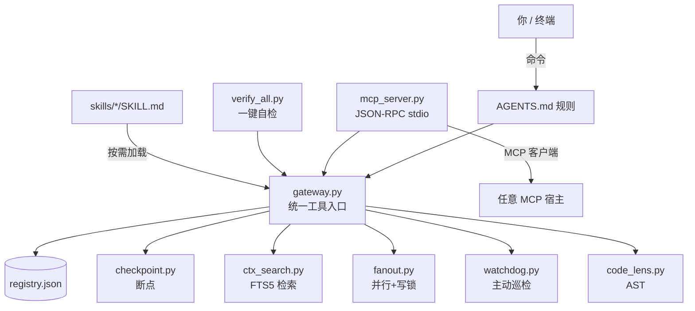

# cc-Harness

> **让 DeepSeek Harness 活成 Claude Code 的样子。**

> [](https://github.com/kaihu8766-netizen/cc-Harness/actions/workflows/ci.yml)

一个不写一行模型代码的「Claude 化」工具包：把你的 DSH（DeepSeek Harness）补上 **技能包+触发词索引 / 工具网关 / 一键自检 / 断点续命 / MCP 服务 / 多级自愈 / 人味机制**，
让它从"能聊天的终端"变成"能干活、能自证、能接活的工程 Agent"。

我们不生产智商，我们只是把工程外挂搬到你车上。🚚

---

## 架构一览



## 先泼一盆冷水（认真的）

- ❌ 这**不会**让你的模型变聪明。模型是模型，工程是工程。
- ❌ 这**不是** Claude Code 的破解版、也不是 Anthropic 的官方项目。
- ✅ 这**会**让你的 DSH：**少犯低级错、错了能自己发现、干完能给你证据、断了能续上**。

一句话：**智商靠模型，靠谱靠这套。**

---

## 它能给你什么

| 能力 | 大白话 | 文件 |
|---|---|---|
| **工具网关** | 所有工具一个入口，报错能自己修一次再试 | `tools/gateway.py` |
| **MCP 服务** | 把你自己的工具包装成 MCP，任何支持 MCP 的客户端都能调 | `tools/mcp_server.py` |
| **一键自检** | 一条命令 13 项体检，全绿才准说"环境正常" | `tools/verify_all.py` |
| **断点续命** | 上下文被压缩/换会话，靠 100 字断点 2 秒续上 | `tools/checkpoint.py` |
| **检索记忆** | 日志/回执/决策进 FTS5，按需检索，不再整段塞上下文 | `tools/ctx_search.py` |
| **并行调度** | 多任务并发，带文件写锁，结果不乱 | `tools/fanout.py` |
| **主动巡检** | 守护进程盯阻塞/失败/预算/截止，出事主动喊 | `tools/watchdog.py` |
| **代码理解** | AST 查函数调用者与上游调用树 | `tools/code_lens.py` |
| **技能包** | 网申填表 / 文档构建 / 部署验证，按需装载 | `skills/` |

---

## 安装（Windows · PowerShell）

```powershell
git clone https://github.com/kaihu8766-netizen/cc-Harness.git
cd cc-Harness
powershell -ExecutionPolicy Bypass -File install.ps1
```

装完跑一次体检：

```powershell
python tools/verify_all.py
```

看到 `ALL PASS` 就算成了（第一次有一两个 FAIL 通常是路径/Drive 之类，脚本会告诉你缺什么）。

### 装到哪了

- `skills/`、`tools/` 会被复制到你当前的 DSH 工作区
- `AGENTS.md` 会**追加**一段带标记的规则块（不会覆盖你原有内容）
- 所有覆盖前都会备份到 `out/backup/`

**卸载**：

```powershell
powershell -ExecutionPolicy Bypass -File uninstall.ps1
```

---

## 使用（三分钟上手）

```powershell
# 1. 看有哪些工具
python tools/gateway.py list

# 2. 跑一个
python tools/gateway.py run guard.ledger

# 3. 挂牌一个任务断点（换会话不迷路）
python tools/checkpoint.py set "正在做什么；卡在哪；下一步"

# 4. 检索历史
python tools/ctx_search.py search "上次那个报错"

# 5. 起 MCP 服务（给别的客户端用）
python tools/mcp_server.py
```

技能包按需加载：

```powershell
python tools/gateway.py skill apply_form
```

---

## 会说话，也是功能（人味机制）

大多数 Agent 工具只给你"手脚"，不管你说话像不像人。cc-Harness 把"语气"也当成一层可配置的东西：

| 资产 | 作用 |
|---|---|
| `persona.md` | 人格模板：口语优先、有主见、认错一句话、禁客服腔、禁油腻陷阱 |
| `user_profile.json` | 记住用户这个人：偏好 / 雷区 / 作息（冷启动先读） |
| `tools/detect_ai_smell.py` | **AI 味检测器**：扫客服腔 / 满篇表格 / 零观点，AI 味 <80 分就打回重写 |

```powershell
python tools/detect_ai_smell.py --text "收到，遵命，为您服务。综上所述，我已完成。"
# => AI 味评分: 0/100（机器味重）  命中: 客服腔 / 零观点
```

装完会部署到 `out/persona.md` 与 `out/user_profile.json`，**不覆盖你已有的版本**。
## 错了会记，记了会学（错误台账）

Agent 最容易重复犯同样的错。cc-Harness 加了一个**错误台账**，把"踩过的坑"变成"下次的规则"：

`powershell
# 手动记一条（症状 / 根因 / 解法 / 分类）
python tools/error_ledger.py add --symptom "上传后附件没变" --cause "盲选第0个file input" --fix "遍历input核对归属" --tag browser

python tools/error_ledger.py stats     # 按标签/状态统计
python tools/error_ledger.py learn     # 同类错误≥2次 → 建议规则行
python tools/error_ledger.py learn --apply   # 直接追加到 DISCIPLINE
`

- **自动捕获**：gateway.py 里工具最终失败（自愈后仍失败）会自动记一条（tag=tool）
- **存储**：out/review/errors/error_ledger.jsonl，append-only，永不删
- **闭环**：
esolve --id N 标记修好；learn 把高频错误提炼成规则

## 技能怎么才会被"想起来"（重要）

光把 `SKILL.md` 放进目录，模型**不会自动去读**——这是实测最容易翻车的地方。cc-Harness 的做法：

1. **生成索引**：`python tools/skills_index.py` → 产出 `skills/INDEX.md`（技能 / 用途 / 触发词 / 加载命令）
2. **冷启动必读索引**：装好的 `AGENTS.md` 里写死"第 N 步读 skills/INDEX.md"
3. **触发词纪律**：用户话里出现索引里的词 → 必须先 `python tools/gateway.py skill <name>` 加载全文，禁止凭记忆做
4. **自检监管**：`verify_all` 会校验索引是否与 SKILL.md 同步，改了技能忘刷索引直接红

> 一句话：**技能不是"放着就会用"，得有索引 + 触发词 + 校验三件套。**

## 设计哲学（其实都是踩坑踩出来的）

1. **未落盘 = 未做**：改完不验证、不写断点，就等于没干过。
2. **单页死守**：填表页绝不跳站，跳走就丢内存态（血泪）。
3. **只认接口回包**：页面"看起来保存了"不算数，抓到 `2xx + status=1` 才算。
4. **失败两次就停**：第三次开始基本是瞎猜。
5. **不硬凑分数**：做不到的维度标注「受限」，比吹牛省事。

---

## 目录结构

```
cc-Harness/
├─ install.ps1              # 安装（带备份）
├─ uninstall.ps1            # 卸载
├─ skills/                  # 技能包
│  ├─ apply_form/SKILL.md
│  ├─ doc_build/SKILL.md
│  └─ deploy_verify/SKILL.md
├─ tools/                   # 工具
│  ├─ gateway.py  registry.json
│  ├─ mcp_server.py
│  ├─ verify_all.py
│  ├─ checkpoint.py
│  ├─ ctx_search.py
│  ├─ fanout.py
│  ├─ watchdog.py
│  └─ code_lens.py
└─ docs/
   ├─ how-it-works.md
   └─ faq.md
```

---

## 常见问题

**Q：能装到 macOS / Linux 吗？**
工具本身是 Python 的，跨平台没问题；`install.ps1` 是 PowerShell 的，Mac/Linux 请手动复制 `skills/`、`tools/` 并追加 `AGENTS.md` 规则块。欢迎 PR 一个 `install.sh`。

**Q：会改我的配置吗？**
只追加 `AGENTS.md` 的标记块，其余不动，且全部先备份。

**Q：有风险吗？**
`watchdog.py` 会读你的断点/回执；`gateway.py` 会执行你注册的工具。**请你自己看一遍再跑**——开源不等于免检。

---

## License

MIT。随便用，出事别找我。（认真的：这是工程脚手架，不提供任何担保。）

---

## 致谢

灵感来自 Claude Code 的「技能 + 工具 + 自检」体验，以及一只被上下文压缩反复折磨的 Agent。🫠
---

## 关于名字

`cc` 指 `Claude Code 化`（描述性引用），不是 Anthropic 的缩写或官方项目代号；仓库与本项目均与 Anthropic 无关。

## 免责声明 / Disclaimer

本项目是**独立社区开源项目**，与 Anthropic、DeepSeek 没有任何隶属、背书或赞助关系。

> This is an independent community open-source project. It is **not affiliated with, endorsed by, or sponsored by** Anthropic or DeepSeek.
> "Claude" 与 "Claude Code" 是 Anthropic 的商标；"DeepSeek Harness" 属 DeepSeek。本项目仅作技术说明性引用，不暗示任何官方关联。


